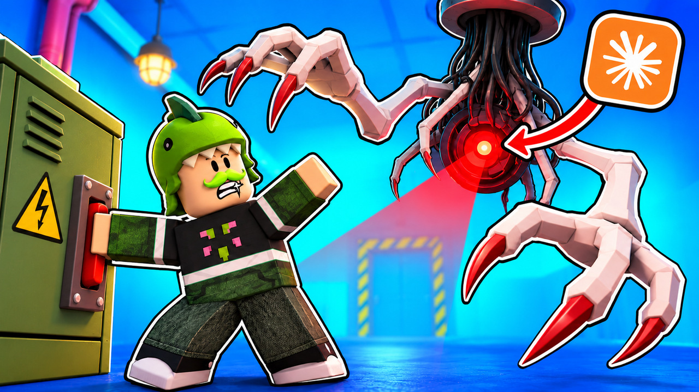
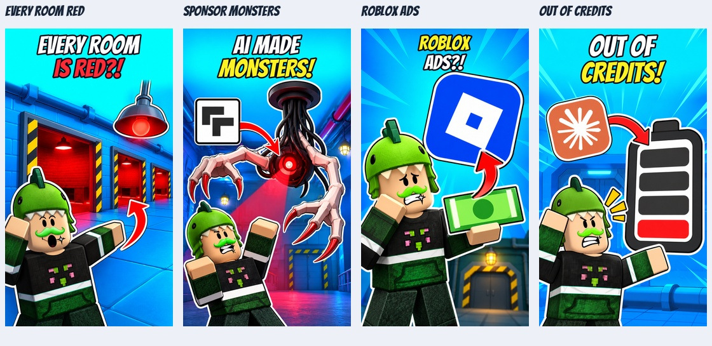
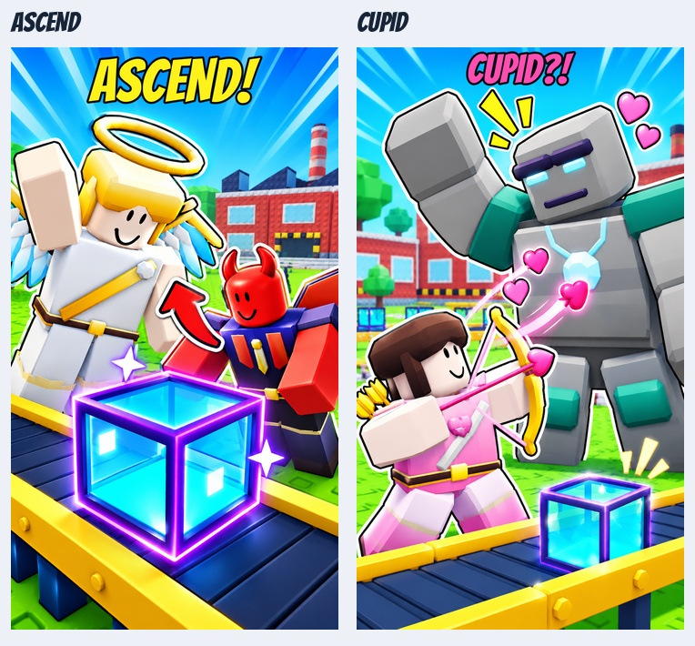

# Roblox Thumbnail Strategy

**A research-backed AI skill for planning, creating, critiquing, and testing Roblox game icons, discovery thumbnails, YouTube devlog thumbnails, and vertical Shorts covers.**

Turn a real gameplay mechanic or video hook into a clear, recognizable visual—without relying on generic clickbait formulas or pretending competitor popularity proves thumbnail performance.

[](https://create.roblox.com/)
[](SKILL.md)
[](scripts/typeset_thumbnail.py)

**[Watch on YouTube](https://www.youtube.com/channel/UC3W2Ocp8Nt2msYkY2-Xkpew/)** · [Explore reference artwork](#example-artwork)

## What it does

- **Roblox game thumbnails:** Develop distinct 16:9 concepts around an experience's actual core action, reward, threat, progression, or social fantasy.
- **Roblox game icons:** Design a separate square composition with a recognizable silhouette or identity that survives small-size viewing.
- **YouTube devlogs:** Build thumbnails around the video's real hook, using actual project assets and creator identity when available.
- **Shorts covers:** Compose native 9:16 covers instead of awkwardly cropping landscape artwork.
- **Visual research:** Use a documented study of Roblox experiences, annotated examples, and saved contact sheets as inspiration and counterexamples.
- **Production and testing:** Plan practical artwork workflows, inspect reduced-size previews, and assess actual metrics when the creator supplies analytics.
- **Clean lettering:** Optionally typeset headlines with real fonts on top of text-free artwork, preserving separate artwork and typography outputs.

This is an **instruction-and-reference skill**, not a standalone image generator or Roblox plugin. Artwork creation depends on the image-generation, editing, rendering, or Roblox Studio tools available to the agent using it.

## Research behind the skill

The research was conducted on **October 17, 2026**, using a supplied Roblox data export and artwork from public Roblox APIs.

| Research detail | Scope |
| --- | ---: |
| Source data rows | 826 |
| Resolved distinct Roblox experiences | 539 |
| Distinct experiences visually reviewed | **432** |
| Icons inspected | **432** |
| Usable custom thumbnails inspected | **429** |
| Labeled visual contact sheets | **18** |

The analysis documents readable actions, progression contrasts, threats, social fantasies, signature imagery, and different icon-versus-thumbnail strategies. It also includes low-CCU counterexamples to avoid drawing simplistic conclusions from successful-looking artwork.

**Important:** Concurrent users (CCU), visits, likes, and visual polish are **not** measurements of click-through rate (CTR), qualified play-through rate (qPTR), retention, or causal thumbnail effectiveness. The study does not claim access to competitors' private analytics or guarantee a performance increase.

Read [research findings](references/research-findings.md), [methodology](references/study-methodology.json), and the [game review ledger](references/game-review-ledger.md) for details.

## Installation

Clone or download the repository into a skills directory supported by your AI agent. The included [`SKILL.md`](SKILL.md) contains the instructions; linked reference documents and assets should remain alongside it.

For example, in an environment that loads local skills from `~/.agents/skills/`:

```bash
mkdir -p ~/.agents/skills
git clone https://github.com/IAmCosmin-YT/roblox-thumbnail-skill.git ~/.agents/skills/roblox-thumbnail-strategy
```

The skill's declared name is `roblox-thumbnail-strategy`. If your agent supports explicit skill invocation, use that name. Otherwise, point the agent to `SKILL.md` and request the desired artwork or critique. **Skill discovery and external image-generation tools depend on your agent's configuration.**

## Example prompts

**Roblox experience thumbnail**

> Use roblox-thumbnail-strategy to propose three different thumbnail concepts for my Roblox horror game. Show the real player objective and threat, choose relevant references from the research, and explain how each concept would work as a separate square icon.

**Game icon critique**

> Review my current Roblox game icon at small sizes. Identify problems with silhouette, contrast, and recognizability, then recommend a clearer composition that still matches my game.

**YouTube devlog**

> Use roblox-thumbnail-strategy to create a 16:9 YouTube thumbnail concept for my Roblox devlog. Base the image on the footage and actual game assets, not an invented moment.

**Shorts cover**

> Design a 9:16 Shorts cover using my supplied Roblox avatar. Keep the headline readable, leave room for platform controls, and prepare text-free artwork for real-font typesetting.

**Variant testing**

> Give me three meaningfully different thumbnail hypotheses, then explain what I should track in Creator Dashboard to compare their results.

## Example artwork

These reference images illustrate the skill's composition and art-direction approaches. They are **visual examples**, not proof of measured click-through performance.

### Roblox devlog thumbnail — BREAKERLINE



A landscape composition using the creator's recognizable blocky avatar, a readable monster silhouette, a prominent red scanner eye, and a bright blue industrial environment.

### Vertical promotional covers



A contact sheet of 9:16 promotional covers. Examples include Roblox advertising and the "Every Room Is Red?!" hook, using strong headline hierarchy, expressive posing, and high-contrast visual cues.

### Additional Shorts artwork



Examples of different game-specific stories: a character interaction, a valuable object, and a progression/reward fantasy. They show why each video needs its own visual premise instead of reusing a single generic layout.

For the complete research-based reference collection, browse the [visual index](references/visual-index.md) and [study contact sheets](assets/study-contact-sheets/).

## Workflow

1. **Understand the real content.** Inspect the game, available assets, gameplay loop, or supplied video before proposing visuals.
2. **Select relevant references.** Compare games serving similar player motivations, including counterexamples, without copying distinctive competitor artwork.
3. **Define the visual promise.** Identify the action, reward, risk, relationship, or identity a viewer should understand immediately.
4. **Design for the surface.** Compose icons, landscape thumbnails, and vertical covers independently while preserving recognizable branding.
5. **Produce and inspect.** Use available rendering or image tools and review the finished artwork at both full size and realistic feed sizes.
6. **Test responsibly.** When analytics exist, compare the relevant exposure, play-through, qualified plays, and post-join experience—not just clicks.

For practical recipes and evaluation guidance, see [production and testing](references/production-and-testing.md).

## Recommended formats and readability checks

| Surface | Working/export size | Small-size review |
| --- | --- | --- |
| Roblox game icon | 512 × 512 | 150 × 150 |
| Roblox discovery thumbnail | 1920 × 1080 | Approximately 384 × 216 |
| YouTube landscape thumbnail | 1920 × 1080 master | Approximately 384 × 216 |
| Vertical Shorts cover | 1080 × 1920 | 360 × 640 and 180 × 320 |

These are the sizes documented in the skill's production guidance, not immutable platform requirements. Check the latest publishing specifications before uploading.

## Optional Python typesetting helper

[`scripts/typeset_thumbnail.py`](scripts/typeset_thumbnail.py) composites **real-font headlines** over existing artwork. It does **not** generate images or alter their subjects.

Requires Python and [Pillow](https://pillow.readthedocs.io/):

```bash
python -m pip install Pillow
```

Create a `config.json` for an existing vertical artwork file:

```json
{
  "source": "./artwork.png",
  "output_dir": "./output/cover-v1",
  "stem": "roblox-cover",
  "size": [1080, 1920],
  "headline": {
    "lines": [
      { "text": "I BUILT", "color": "#ffffff" },
      { "text": "A MONSTER!", "color": "#fff224" }
    ],
    "box": [70, 35, 940, 300],
    "max_font": 235,
    "min_font": 70,
    "stroke": 9,
    "gap": 12
  }
}
```

Then run:

```bash
python scripts/typeset_thumbnail.py --config config.json
```

The helper produces PNG/JPEG composites, a transparent typography layer, text-free artwork, a preview, layout metadata, and a copy of the native input. It also copies the font and available license into the output when a headline is used. Set `"headline": null` for text-free output. The helper refuses to overwrite existing output files, so use a new versioned output directory for revisions.

See [YouTube and Shorts guidance](references/youtube-and-shorts.md) for composition and headline constraints.

## Repository structure

```text
roblox-thumbnail-skill/
├── SKILL.md                        # Agent instructions and decision framework
├── agents/
│   └── openai.yaml                # Skill display metadata and default prompt
├── references/
│   ├── research-findings.md       # Main research report
│   ├── game-review-ledger.md      # Individual game observations
│   ├── study-methodology.json     # Dataset and review methodology
│   ├── visual-index.md            # Index of visual evidence boards
│   ├── production-and-testing.md  # Creation and evaluation workflows
│   ├── ai-artwork-production.md   # AI-assisted artwork guidance
│   └── youtube-and-shorts.md      # Video thumbnails and vertical covers
├── assets/
│   ├── study-contact-sheets/      # Archived visual reference boards
│   ├── creator-thumbnail-examples/
│   ├── emotion-factory-examples/
│   └── fonts/                     # Typography assets and associated licenses
└── scripts/
    └── typeset_thumbnail.py       # Real-font thumbnail compositing helper
```

The [visual index](references/visual-index.md) links the archived contact sheets to the reviewed examples.

## Creative principles

- **Show the game's real promise.** A compelling thumbnail should depict an activity, payoff, threat, or fantasy the experience actually delivers.
- **Make it work small.** Prioritize subject scale, silhouette, contrast, and clear visual relationships before secondary details.
- **Don't use one formula for every game.** Cozy, social, horror, simulator, sports, and action experiences benefit from different visual languages.
- **Treat icons and thumbnails differently.** The icon can emphasize identity while the wide image explains an encounter or gameplay moment.
- **Use references, don't clone them.** Translate useful composition decisions instead of copying a competitor's unique characters, logos, or arrangement.
- **Distinguish evidence from assumptions.** Visual observations, hypothetical production methods, and verified analytics are different things.
- **Preserve editability when possible.** Keep original assets, text-free masters, overlays, and versioned exports.

## Limitations

This repository contains creative instructions, reference research, example artwork, and an optional compositing script. It does not bundle Roblox Studio, Blender, an image-generation model, a publishing integration, or automatic access to game assets and private analytics. A compatible agent or external tools must supply those capabilities.

Research represents a **dated, API-availability-constrained sample**. Artwork, game popularity, and publishing requirements may have changed. Any assessment of performance should be tested on the creator's own traffic and audience.

## Author

Created by [IAmCosmin-YT](https://github.com/IAmCosmin-YT). Watch my Roblox development videos and devlogs on **[YouTube](https://www.youtube.com/channel/UC3W2Ocp8Nt2msYkY2-Xkpew/)**.

For suggestions, corrections, or improvements, [open an issue](https://github.com/IAmCosmin-YT/roblox-thumbnail-skill/issues).

---

**Create artwork that communicates the game—not just artwork that looks clickable.**
